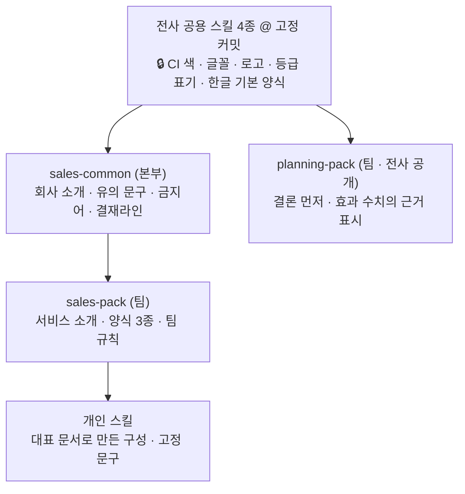
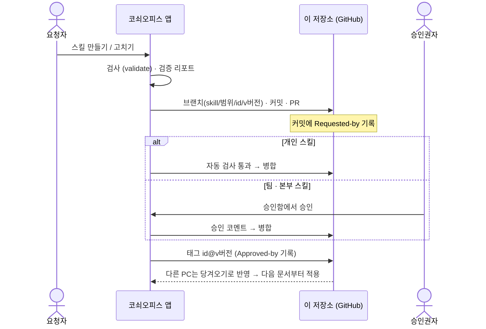

<div align="center">

# 코쇠오피스 스킬 저장소 (kosoe-office-skills)

**부서 · 개인 문서 스킬의 정본. 전사 공용 스킬을 상속하고, PR로 등록하고, 태그로 버전을 남깁니다.**


[스킬이란](#스킬이란) · [스킬 목록](#스킬-목록) · [써 보기](#써-보기) · [스킬 만들기](#스킬-만들기) · [파일 형식](#kosoe-skillyaml-형식) · [앱 저장소 ↗](https://github.com/humanist96/kosoe-office)


</div>

---

## 스킬이란

스킬은 **한 부서(또는 한 사람)가 문서를 쓰는 방식**을 담은 폴더입니다. 어떤 장 구성으로, 어떤 문구를 글자 그대로 넣고, 어떤 표현을 쓰지 않으며, 누구에게 결재를 올리는지를 `kosoe-skill.yaml` 한 파일에 적습니다.

- 스킬은 혼자 서지 않습니다. 반드시 **전사 공용 스킬**(한글 · PPT · 웹슬라이드 · 삽화 엔진)이나 다른 스킬을 **상속**합니다.
- [코쇠오피스](https://github.com/humanist96/kosoe-office) 앱은 이 저장소를 당겨 와서 **승인된 최신 버전**으로 문서를 만듭니다. 앱의 데이터베이스는 캐시일 뿐이고 정본은 여기입니다.
- 스킬을 등록하거나 바꾸는 일은 모두 **PR**이고, 승인은 **병합 + 버전 태그**입니다. 그래서 누가 언제 무엇을 바꿨는지가 Git에 남고, 이전 버전으로 되돌릴 수 있습니다.

> 조직 · 사람 · 고객 · 숫자는 모두 **가상**입니다. 원문 파일은 올리지 않습니다. 구조 · 고정 문구 · 규칙 · 검증 과제만 있습니다.

## 목차

- [저장소 구성](#저장소-구성)
- [스킬 목록](#스킬-목록)
- [써 보기](#써-보기)
- [스킬 만들기](#스킬-만들기)
- [`kosoe-skill.yaml` 형식](#kosoe-skillyaml-형식)
- [상속 규칙](#상속-규칙)
- [등록 · 승인 · 복구 흐름](#등록--승인--복구-흐름)
- [검사](#검사)
- [전사 공용 스킬 갱신](#전사-공용-스킬-갱신)
- [자주 묻는 질문](#자주-묻는-질문)

## 저장소 구성

```
kosoe-office-skills/
├─ registry/
│  ├─ corp.lock.yaml        전사 공용 스킬의 고정 커밋 + 잠금 항목
│  ├─ corp.forms.yaml       전사 공통 양식 목록 (전사 스킬이 만드는 문서 종류)
│  └─ samples/<양식 id>/    전사 양식 카드의 샘플 그림 (01.webp … · sample.json)
├─ corp/
│  └─ koscom-hwp-pb-contract/        목적별 한글 스킬 — PB 추가업무 이용 계약서 (서식 채우기형)
├─ skills/
│  ├─ org/<본부>[/<팀>]/<스킬 id>/     본부 · 팀 스킬
│  └─ user/<사용자 id>/<스킬 id>/      개인 스킬
├─ tools/
│  ├─ validate.py           저장소 검사 (앱도 같은 규칙으로 검사)
│  └─ ci/validate.yml       GitHub Actions 워크플로 (아직 켜지 않음 — 아래 「검사」)
└─ .github/CODEOWNERS       폴더별 승인권자
```

스킬 폴더 하나의 모습:

```
sales-pack/
├─ kosoe-skill.yaml         상속 · 양식 · 고정 문구 · 용어 · 검수 규칙 · 결재라인  ← 필수
├─ SKILL.md                 언제 · 어떻게 쓰는 스킬인지 (사람과 AI가 읽는 설명)
├─ evals/case-N/            검증 과제 — case.yaml(기대 구성 · 고정 문구 · 채점 결과). 과제 메모는 올리지 않음(아래 「자주 묻는 질문」)
└─ samples/<양식 id>/       이 스킬 양식 카드의 샘플 그림 (없어도 됨)
```

### 양식 카드 샘플 그림

앱의 새 문서 화면에서 양식 카드를 누르면 그 양식으로 만든 문서의 앞쪽 몇 장을 보여 줍니다. 그림은 이 저장소에서 읽습니다.

| 양식 | 폴더 |
|---|---|
| 전사 양식 (`registry/corp.forms.yaml`) | `registry/samples/<양식 id>/` |
| 스킬의 양식 | `<스킬 폴더>/samples/<양식 id>/` |

- 폴더에는 `01.webp` · `02.webp` …(보이는 순서)와 그 그림을 만든 설계도 `sample.json`이 있습니다.
- 그림은 앱의 `tests/make_samples.py`로 만듭니다. 가상의 주제로 설계도를 짓고, **그 양식의 전사 엔진으로** 문서를 만들어 그림으로 뜹니다. 카드에서 본 모양과 실제 결과가 같아야 하므로 다른 엔진으로 그린 그림을 옮겨 오지 않습니다.
- 지금 있는 것: PPT 2종(`deck-proposal` · `deck-exec`), 웹 2종(`web-brief` · `web-edu`), 영업 팩의 제안서 · 브리핑. **한글 양식은 아직 없습니다** — 한컴 한글이 깔린 PC에서 그려야 합니다. 그림이 없는 양식은 같은 형식의 전사 샘플을 빌려 보이고, 빌릴 것도 없으면 카드를 눌러도 고르기만 합니다.
- 공개 저장소이므로 샘플 내용은 모두 가상입니다(고객사는 A증권 · B은행, 사람은 가상 조직의 이름). 실제 문서의 글 · 숫자 · 이름으로 샘플을 만들지 않습니다.

## 스킬 목록

### 전사 공용 스킬 (엔진)

[`registry/corp.lock.yaml`](registry/corp.lock.yaml)에 **커밋 단위로 고정**되어 있습니다. 앱은 여기 적힌 커밋을 받아 엔진으로 실행합니다.

| id | 저장소 | 맡는 일 |
|---|---|---|
| `koscom-hwp-report` | [koscom_hangul_skill](https://github.com/humanist96/koscom_hangul_skill) | 한글 `.hwp` 요약보고 렌더러, 보고 문법 |
| `koscom-doc-pack` | [koscom-doc-pack](https://github.com/humanist96/koscom-doc-pack) (비공개) | 형식 라우터, `ppt-master`(Koscom 셰브론 덱) |
| `koscom-webslide` | [koscom_webslide](https://github.com/humanist96/koscom_webslide) | 움직이는 단일 HTML 웹슬라이드 |
| `kosoe-illustrations` | [koscom-kosoe-illustrations](https://github.com/humanist96/koscom-kosoe-illustrations) | 코쇠 삽화 |
| `koscom-hwp-pb-contract` | 이 저장소의 [`corp/koscom-hwp-pb-contract`](corp/koscom-hwp-pb-contract) | 한글 `.hwp` **PB 전산서비스 추가업무 이용 계약서** — 서식 채우기형(`kind: hwp-fill`) |

전사 스킬이 만드는 문서 종류(결과보고 · 계획보고 · 제안서 덱 · 브리핑 웹슬라이드 등 14종)는 [`registry/corp.forms.yaml`](registry/corp.forms.yaml)에 있습니다.

#### 한글 스킬은 목적마다 따로

한글 문서는 목적에 따라 모양이 전혀 다릅니다. 보고서는 `□ ㅇ -` 개조식이고, 계약서 · 공문은 조항과 서명란이 정해져 있습니다. 보고서 스킬 하나로 계약서를 만들면 계약서가 보고서 모양으로 나옵니다. 그래서 모양이 정해진 문서는 **서식 채우기형 스킬**로 따로 만듭니다.

| | 보고서 스킬 (`koscom-hwp-report`) | 서식 채우기형 스킬 (`kind: hwp-fill`) |
|---|---|---|
| 방식 | 문단 블록을 조립 | 실제 문서에서 바뀌는 글만 `{{칸}}`으로 비운 서식에 값을 넣음 |
| AI가 쓰는 것 | 장 · 항목 · 표 | 칸의 값만. 조항 문장은 서식에 있어 쓰지 않음 |
| 양식 카드 | `registry/corp.forms.yaml` | 스킬 폴더의 `form.yaml`이 곧 전사 양식 카드 |
| 검수 | 보고 문법 · 팩 규칙 | 필수 칸 · 칸 형식 · 표(합계 자동) |

새 목적의 한글 스킬(다른 계약서, 공문 등)을 추가하는 순서:

1. `corp/<스킬 id>/` 폴더를 만듭니다. [`corp/koscom-hwp-pb-contract`](corp/koscom-hwp-pb-contract)를 본뜨면 됩니다 — `form.yaml`(칸 정의) · `templates/*.hwp`(서식) · `scripts/*.jar`(채우기 렌더러) · `SKILL.md`.
2. 서식은 실제 문서에서 고객사명 · 금액 · 사람 이름을 칸으로 바꿔 만듭니다([안내](corp/koscom-hwp-pb-contract/references/template_guide.md)). **원본 문서는 올리지 않습니다.**
3. 그 폴더가 들어간 커밋을 `registry/corp.lock.yaml`에 `kind: hwp-fill`로 고정합니다. 앱 코드는 고치지 않습니다.

```yaml
koscom-hwp-pb-contract:
  repo: humanist96/kosoe-office-skills
  path: corp/koscom-hwp-pb-contract
  sha: <그 폴더가 들어 있는 커밋>
  kind: hwp-fill
```

### 부서 스킬 (가상 조직)

| 스킬 | 범위 | 상속 | 양식 |
|---|---|---|---|
| [`sales-common`](skills/org/금융영업본부/sales-common) 금융영업본부 공통 팩 | 본부 | 전사 4종 | (양식 없음 — 회사 소개 · 유의 문구 · 금지어 · 결재라인) |
| [`sales-pack`](skills/org/금융영업본부/금융영업1팀/sales-pack) 영업 팩 | 팀 | `sales-common` → 전사 | 고객 제안서(PPT) · 고객 브리핑(웹) · 방문 보고(한글) |
| [`planning-pack`](skills/org/경영기획본부/경영기획팀/planning-pack) 기획 팩 | 팀 · 전사 공개 | 전사(한글 · PPT · 삽화) | 기획 요약보고(한글) |

개인 스킬은 `skills/user/<사용자 id>/` 아래에 생깁니다. 버전은 `git tag -l "<스킬 id>@v*"`로 봅니다.


## 써 보기

### 코쇠오피스 앱에서 (권장)

앱이 이 저장소를 알아서 당겨 옵니다. 스킬을 손으로 받을 필요가 없습니다.

```bash
git clone https://github.com/humanist96/kosoe-office && cd kosoe-office
./setup.sh            # Windows는 .\setup.ps1
python kosoe.py       # → http://localhost:8810
```

- **새 문서** — 양식 카드에 `sales-pack@1.5.1 ← sales-common ← 전사`처럼 스킬과 상속 사슬이 보입니다. 카드를 골라 문서를 만들면 그 스킬의 구성 · 고정 문구 · 규칙이 적용됩니다.
- **스킬** — 상속 사슬, 고정 문구의 출처, 버전 태그, 파일을 봅니다. 「⟳ 당겨오기」로 다른 PC에서 승인한 변경을 받습니다.
- **스킬 만들기** — 대표 문서로 스킬을 만들어 이 저장소에 PR로 등록합니다.

### 이 저장소만 받아서

```bash
git clone https://github.com/humanist96/kosoe-office-skills && cd kosoe-office-skills
pip install pyyaml
python tools/validate.py          # 저장소 전체 검사
git tag -l "sales-pack@v*"        # 영업 팩의 버전들
git show sales-pack@v1.4.0:"skills/org/금융영업본부/금융영업1팀/sales-pack/kosoe-skill.yaml"   # 그 버전의 내용
```

## 스킬 만들기

### 방법 1 — 대표 문서로 자동 생성 (앱)

1. 앱의 **스킬 만들기**에서 초안이나 기존 문서를 올리고 한 줄로 요청합니다. 예: `영업팀 제안서 팩 만들어줘`
2. 앱이 공통 목차 · 고정 문구 · 바뀌는 칸을 뽑고, **상속할 상위 스킬**(내 팀 → 내 본부 → 전사)을 찾아 `kosoe-skill.yaml` 초안을 만듭니다. 이때 대표 문서의 **문체**(종결 형태 · 날짜 형식 · 항목 길이)도 잽니다 — [보고서가 아닌 문서](#보고서가-아닌-문서-계약서--공문-등).
3. 대표 문서에서 만든 과제로 **스킬 사용 / 미사용**을 채점합니다. 아래 7개 기준을 모두 통과해야 등록 버튼이 열립니다.
4. 등록을 누르면 브랜치 · 커밋 · PR이 생깁니다.

| 기준 | 채점 방법 | 통과 |
|---|---|---|
| 구성 재현 | 생성한 설계도의 장 순서를 기대 목차와 비교 | 95% 이상 |
| 고정 문구 | 고정 문구가 결과에 글자 그대로 있는지(`[칸 이름]` 자리는 어떤 값이든) | 전부 |
| 숫자 · 사실 보존 | 메모의 숫자가 빠지거나 새 숫자가 생기지 않았는지 | 변경 0건 |
| 보고 문법 / 문체 | 날짜 형식 · 항목 길이 · 종결 형태. 스킬에 `style`이 없으면 전사 보고 문법, 있으면 대표 문서에서 잰 문체 | 위반 0건 |
| 보안 | `kosoe-skill.yaml`에 휴대전화번호 · 주민등록번호 · 이메일 · 계좌번호로 보이는 값이 없는지 | 0건 |
| 효과 비교 | 같은 과제의 스킬 사용 점수 > 미사용 점수 | 사용이 높음 |
| 사람 확인 | 담당자 시범 작성 👍 | 개인 1건 · 부서 3건 |

<table>
<tr>
<td width="50%"><br>② 분석 · ③ 상속 기반 초안</td>
<td width="50%"><br>④ 검증 리포트 — 스킬 사용 12/12, 미사용 6/12</td>
</tr>
</table>

#### 보고서가 아닌 문서 (계약서 · 공문 등)

대표 문서가 개조식 보고서가 아니면(문장이 `~한다.`로 끝나거나, 한 항목이 90자를 넘거나, 날짜를 `2019.03.15`처럼 쓰는 문서) 전사 보고 문법 대신 **그 문서의 문체**로 스킬을 만들고 검증합니다.

- 문체는 AI가 아니라 코드가 대표 문서의 글에서 잽니다. 결과는 양식의 `style`에 적히고, 그 스킬로 문서를 쓸 때의 작성 규칙 · 검수 · 자동 수정이 모두 이 값을 따릅니다.
- 보고 문법과 어긋나지 않는 문서는 `style`을 적지 않습니다(전사 보고 문법을 그대로 상속).
- 조항처럼 틀은 같고 값만 바뀌는 고정 문구는 바뀌는 자리를 `[칸 이름]`으로 적습니다. 예: `[고객사명](이하 "갑"이라 한다)`. 칸 밖의 글자가 그대로면 고정 문구를 지킨 것으로 보고, 채워지지 않은 칸은 검수에서 「확인 필요」로 잡힙니다.
- 문서 모양(표지 · 쪽 배치)은 여전히 전사 한글 · PPT · 웹 엔진의 양식입니다. 계약서 전용 서식으로 출력하지는 않습니다.

#### 검증 미통과 강제 등록

검증 기준을 통과하지 못해도 **사유를 적으면** 등록할 수 있습니다(앱의 「미통과 항목이 있어도 등록」).

- 넘길 수 있는 것: 구성 재현 · 고정 문구 · 숫자 보존 · 문체 · 효과 비교 · 사람 확인.
- 넘길 수 없는 것: 스킬 파일 검사 오류(스키마 · 상속 · 잠금)와 보안(개인정보로 보이는 값).
- 미통과 항목과 사유는 PR 본문, `kosoe-skill.yaml`의 `verification`, `SKILL.md`에 남고 앱의 스킬 목록에 「검증 미통과 등록」으로 표시됩니다. 팀 · 본부 스킬은 승인권자가 이 내용을 보고 승인 여부를 정합니다.

### 방법 2 — 손으로 쓰기

1. 범위에 맞는 폴더를 만듭니다. 폴더 위치가 범위와 다르면 검사에서 걸립니다.

   | 범위 | 폴더 |
   |---|---|
   | 본부 | `skills/org/<본부>/<스킬 id>/` |
   | 팀 | `skills/org/<본부>/<팀>/<스킬 id>/` |
   | 개인 | `skills/user/<사용자 id>/<스킬 id>/` |

2. `kosoe-skill.yaml`을 씁니다. 가장 작은 예:

   ```yaml
   id: my-weekly
   name: 나의 주간 보고 팩
   scope: user
   owner: u1
   version: 1.0.0
   extends:
     - corp:koscom-hwp-report
   forms:
     - id: main
       name: 나의 주간 보고
       fmt: hwp
       outline: [금주 실적, 차주 계획, 이슈]
   blocks:
     - id: closing
       heading: 이슈
       text: 다음 주 계획은 팀 회의에서 확정함
   ```

3. 검사하고 PR을 올립니다.

   ```bash
   python tools/validate.py skills/user/u1/my-weekly
   git checkout -b skill/user/my-weekly/v1.0.0
   git add skills/user/u1/my-weekly && git commit -m "skill(user): my-weekly v1.0.0"
   git push -u origin skill/user/my-weekly/v1.0.0 && gh pr create --fill
   ```

4. 병합한 뒤 버전 태그를 붙입니다(앱에서 승인하면 자동으로 붙습니다).

   ```bash
   git tag -a "my-weekly@v1.0.0" -m "my-weekly v1.0.0" && git push origin "my-weekly@v1.0.0"
   ```

## `kosoe-skill.yaml` 형식

| 항목 | 필수 | 뜻 |
|---|:---:|---|
| `id` | ✓ | 저장소 안에서 하나뿐인 이름. 폴더 이름과 같게 |
| `name` | ✓ | 화면에 보이는 이름 |
| `scope` | ✓ | `org`(본부 · 팀) 또는 `user`(개인) |
| `org` | org일 때 | `본부` 또는 `본부/팀`. 폴더 경로와 같아야 합니다 |
| `owner` | user일 때 ✓ | 개인 스킬은 사용자 id, 조직 스킬은 담당자 이름 |
| `version` | ✓ | `1.2.3` 형식. 바꿀 때마다 올립니다 |
| `extends` | ✓ | 상속할 대상 목록. `corp:<전사 스킬 id>` 또는 `skill:<스킬 id>` |
| `share` | | `corp`이면 팀 스킬을 전사에 공개 |
| `grade` | | 기본 보안 등급. `c` 대외비 · `i` 사내한정 · `n` 일반 |
| `forms` | | 이 스킬이 만드는 문서 종류(아래) |
| `blocks` | | 고정 문구. `id` · `heading`(들어갈 장) · `text`(글자 그대로 들어갈 문장) |
| `glossary` | | `terms`(용어: 풀이) · `banned`(쓰지 않을 표현) |
| `checks` | | `required`(꼭 들어가야 할 문구) · `banned`(금지어) |
| `rules` | | 작성 규칙 문장 목록. AI에게 그대로 전달됩니다 |
| `approval_line` | | 결재라인. 예: `[담당, 팀장, 본부장]` |
| `illust_topics` | | 어울리는 삽화 주제 |
| `style` | | 문체(아래). 양식에 적은 `style`이 이 값보다 우선합니다 |
| `verification` | | 앱이 적는 검증 기록. `status: forced`이면 검증 미통과 상태로 강제 등록한 스킬(`failed` · `reason` · `by` · `date`) |

`forms`의 한 항목:

| 항목 | 필수 | 뜻 |
|---|:---:|---|
| `id` · `name` | ✓ | 양식 이름. 앱에서는 `<스킬 id>:<양식 id>`로 구분합니다 |
| `fmt` | ✓ | `hwp` · `ppt` · `web` |
| `outline` | ✓ | 장 제목 목록(이 순서 그대로) |
| `desc` · `use` | | 카드에 보이는 설명 · 용도 |
| `preset` | | 한글일 때 전사 한글 스킬의 프리셋 id (예: `visit-report`) |
| `blocks` | | 이 양식에 넣을 고정 문구 id 목록. 비우면 상속받은 것까지 모두 |
| `grade` | | 이 양식만의 보안 등급 |
| `style` | | 이 양식의 문체. 없으면 전사 보고 문법(명사형 종결 · `2026. 10. 28` · 90자) |

`style`의 항목(모두 선택):

| 항목 | 값 | 뜻 |
|---|---|---|
| `ending` | `noun` · `plain` · `polite` · `any` | 종결 형태. 명사형(~함) · 서술형(~한다) · 존댓말(~합니다) · 자유 |
| `date` | `Y. M. D` · `Y.MM.DD` · `Y-MM-DD` · `Y년 M월 D일` · `any` | 날짜 형식 |
| `max_len` | 정수 | 한 항목의 글자 수 한도. `0`이면 제한 없음 |

```yaml
forms:
  - id: main
    name: 전산서비스 추가업무 계약서
    fmt: hwp
    outline: [제1조 목적, 제2조 서비스의 내용, 제3조 서비스 이용료]
    style: {ending: plain, date: Y.MM.DD, max_len: 250}
blocks:
  - id: b1
    heading: 제1조 목적
    text: '[고객사명](이하 "갑"이라 한다)와 … "갑"과 "을"이 [기본계약 체결일] 체결한 …'
```

실제 예는 [`sales-pack/kosoe-skill.yaml`](skills/org/금융영업본부/금융영업1팀/sales-pack/kosoe-skill.yaml)을 보세요.

## 상속 규칙



1. **위에서 아래로 해석합니다.** 전사 → 본부 → 팀 → 개인.
2. **합치는 것**: 고정 문구(`blocks`), 용어, 금지어, 필수 문구, 작성 규칙, 삽화 주제는 위아래 것을 모두 씁니다.
3. **덮는 것**: 같은 `id`의 고정 문구, 결재라인, 보안 등급은 아래 것이 이깁니다.
4. **잠금 항목은 바꿀 수 없습니다.** `brand` · `fonts` · `logo` · `grade_label` · `hwp_base`를 스킬에 적으면 검사에서 걸립니다. 전사 CI와 한글 기본 양식은 전사 공용 스킬만 정합니다.
5. **문서에는 당시 버전이 남습니다.** 문서를 만들 때 쓴 전사 스킬 커밋과 스킬 버전을 기록하고, 이미 만든 문서는 자동으로 바꾸지 않습니다. 승인된 변경은 다음 문서부터 반영됩니다.

`skill:<id>@<버전>`처럼 상위 스킬의 버전을 고정하는 표기는 아직 적용되지 않습니다. 항상 상위 스킬의 승인된 최신 내용을 상속합니다.

## 등록 · 승인 · 복구 흐름



| 범위 | 승인 | 비고 |
|---|---|---|
| 개인 (`skills/user/…`) | 자동 검사 통과 시 바로 병합 | 본인만 씁니다 |
| 팀 (`skills/org/<본부>/<팀>/…`) | 팀장 | 팀원 전원에게 반영 |
| 본부 (`skills/org/<본부>/…`) | 부서 관리자 | 본부 전원에게 반영 |
| 전사 공개 (`skills/org/<본부>/…` + `share: corp`) | 부서 관리자 → 전사 관리자 | 모든 사람의 양식 카드. 개인 · 팀 스킬은 앱 스킬 화면의 「검수 요청」으로 올립니다 |
| `registry/` | 전사 관리자 | 직접 PR ([전사 공용 스킬 갱신](#전사-공용-스킬-갱신)) |

- **변경**: 버전을 올린 PR(예: `1.4.0` → `1.5.0`)을 엽니다.
- **복구**: 이전 태그의 내용으로 되돌리는 PR을 엽니다. 버전 번호는 뒤로 가지 않고 앞으로 갑니다(예: `1.5.0` → `1.5.1`).
- **검수 요청(범위 올리기)**: 스킬 폴더를 새 범위 자리로 옮기는 PR을 엽니다. id는 그대로, 버전은 minor를 올립니다(예: `1.6.1` → `1.7.0`). 브랜치는 `skill/org/<id>/v<버전>`입니다. 올릴 범위보다 좁은 스킬을 상속하고 있으면 올릴 수 없습니다.
- **승인권자가 없는 단계**: 그 팀에 팀장이 없으면 부서 관리자가, 그 본부에 부서 관리자가 없으면 전사 관리자가 대신 승인합니다.
- **기록**: 브랜치 `skill/<범위>/<id>/v<버전>`, PR 라벨 `scope:user` · `scope:org`, 커밋의 `Requested-by:`, 태그 메시지의 `Approved-by:`.


> 시연에서는 GitHub 계정 하나로 요청과 승인을 모두 하므로 브랜치 보호를 켜지 않았고, 누가 요청 · 승인했는지는 가상 사용자 이름으로 남깁니다. 실제 운영에서는 각자 계정으로 PR을 올리고 [CODEOWNERS](.github/CODEOWNERS)와 브랜치 보호로 승인권자를 강제합니다.

## 검사

```bash
pip install pyyaml
python tools/validate.py                 # 저장소 전체
python tools/validate.py skills/org/금융영업본부      # 한 폴더 아래만
```

검사하는 것:

- 필수 항목(`id` · `name` · `scope` · `version`)과 버전 형식
- 폴더 위치가 범위(`scope` · `org` · `owner`)와 맞는지, `id`가 겹치지 않는지
- `extends`가 있는지, 가리키는 전사 스킬이 잠금 파일에 있고 상위 스킬이 저장소에 있는지
- 전사 잠금 항목을 바꾸려 하지 않는지
- 양식의 `fmt`와 `outline`, `style` 값, `verification.status`
- 휴대전화번호 · 주민등록번호 · 이메일 · 계좌번호로 보이는 값

앱도 같은 규칙으로 등록 전에 검사합니다. GitHub Actions 워크플로는 [`tools/ci/validate.yml`](tools/ci/validate.yml)에 보관해 두었고 아직 켜지 않았습니다. 켜려면 `workflow` 권한이 있는 계정으로 이 파일을 `.github/workflows/`로 옮깁니다.

## 전사 공용 스킬 갱신

전사 스킬의 새 버전을 쓰려면 [`registry/corp.lock.yaml`](registry/corp.lock.yaml)의 `sha`를 바꾸는 PR을 올립니다. 병합되면 각 PC가 당겨 온 뒤 **다음 문서부터** 새 엔진으로 만듭니다. 이미 만든 문서에는 당시 커밋이 기록되어 있습니다.

```yaml
corp_skills:
  koscom-hwp-report:
    repo: humanist96/koscom_hangul_skill
    sha: 19bd93b30619d28c0946ebfcd2e50b032d752a29   # ← 이 값을 새 커밋으로
locked_keys: [brand.ci_colors, brand.fonts, brand.logo, doc.grade_label, hwp.base_template]
```

이 작업은 아직 앱 화면이 없어 직접 PR로 합니다.

## 자주 묻는 질문

**스킬과 양식은 무엇이 다른가요?**
양식은 문서 종류 하나(예: 고객 제안서 PPT)이고, 스킬은 양식 여러 개와 그 부서의 공통 규칙을 묶은 것입니다. 앱의 카드 하나가 양식 하나입니다.

**부서마다 스킬이 난립하지 않나요?**
모든 스킬은 전사 공용 스킬을 상속하고, CI · 글꼴 · 로고 · 등급 표기 · 한글 기본 양식은 잠겨 있어 바꿀 수 없습니다. 팀 · 본부 스킬은 승인권자가 병합해야 반영됩니다.

**AI가 만든 스킬을 믿어도 되나요?**
바로 쓰지 않습니다. 구성 재현 · 고정 문구 · 숫자 보존 · 보고 문법 · 보안을 자동 채점하고, 스킬을 쓸 때와 안 쓸 때를 비교한 리포트를 PR 본문에 붙입니다. 기준을 넘고 사람이 확인해야 등록됩니다.

**스킬을 바꾸면 이미 만든 문서도 바뀌나요?**
아니요. 이미 만든 파일은 그대로 두고, 문서를 열면 「새 기준으로 다시 만들기」 알림이 뜹니다.

**대표 문서 원문이 저장소에 올라가나요?**
올라가지 않습니다. 앱이 올리는 것은 스킬 파일(`kosoe-skill.yaml` · `SKILL.md`)과 채점 결과(`evals/case-N/case.yaml`)뿐입니다. 대표 문서에서 뽑은 줄로 만든 검증 과제 메모는 등록한 PC에만 남고, 채점 결과의 빠진 숫자 · 새 숫자도 값이 아니라 건수로 적습니다. 예전에 등록한 가상 자료 스킬에는 `prompt.md`가 남아 있습니다.

다만 **고정 문구와 작성 규칙은 스킬의 내용이라 그대로 올라갑니다.** 이 저장소는 공개 저장소이므로, 실제 문서의 문장이나 고객사명이 고정 문구에 들어가지 않게 등록 전에 확인하세요(앱의 등록 화면이 회사 이름으로 보이는 글을 알려 줍니다).

**문제가 생기면 어떻게 되돌리나요?**
앱의 스킬 화면에서 이전 버전의 「복구 요청」을 누르거나, 그 태그의 내용으로 되돌리는 PR을 직접 올립니다.

---

「ㅋㅋ톤 2026」 본선 출품작의 일부입니다 · 앱: [humanist96/kosoe-office](https://github.com/humanist96/kosoe-office) · 비공개 저장소이며 별도의 공개 라이선스를 두지 않습니다.
